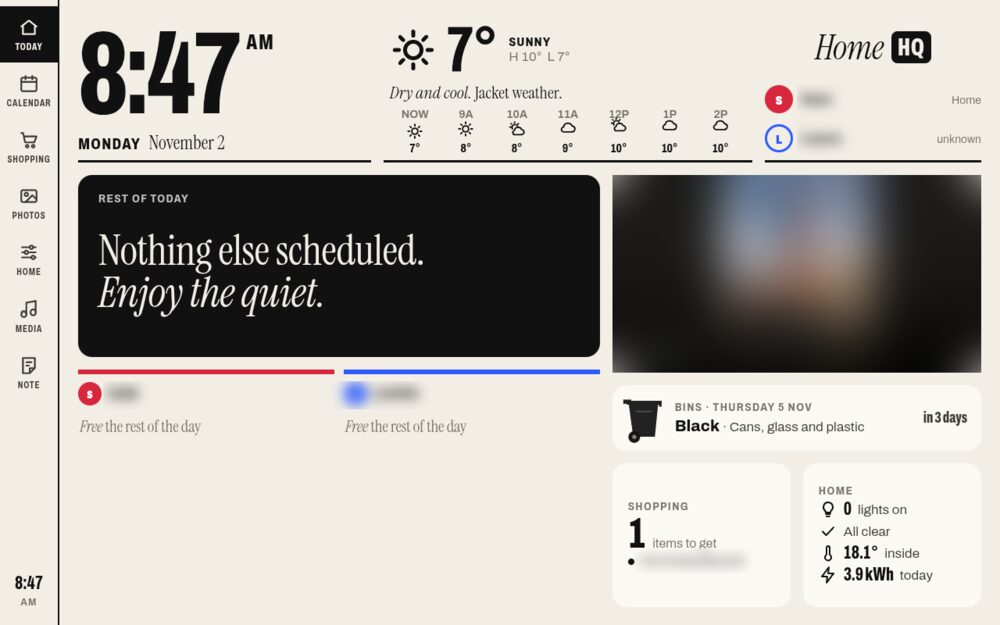

# Home HQ: what this fork adds

The dashboard in this folder started as the demo from the video: a good-looking 1280×800 screen
with made-up data. This fork turns it into something that runs a household. It uses real calendars,
weather, shopping lists, photos, Home Assistant and phone notifications, and it has been running on
two frames since mid-October 2026. This page lists what changed. How to set it up and use it is in the
[README](README.md), the technical history and the reasons behind each choice are in the
[DEVLOG](DEVLOG.md), and the kiosk app is in [kiosk/README.md](kiosk/README.md).

Tested on two frames: the **C-2 10.1" digital calendar** (Allwinner A133, Android 10, see
[joyhong-c2-a133.md](../docs/joyhong-c2-a133.md)) and the **PF1007L** (Allwinner A33, Android 6,
WebView 106, see [allwinner-a33-pf1007l.md](../docs/allwinner-a33-pf1007l.md)). It runs on a
Cloudflare Worker on the **free plan**: a domain name, and nothing for hosting.

*From the C-2. The family photo, the names and a shopping item are blurred.*

## What it does

**Today**
- **Next up** with a **leave-by countdown**: live drive times from Google Routes (capped at 300
  lookups a day), a green **Leave now** with a chime, and "Running late" while anyone on the event is
  still at home.
- **Weather** from Open-Meteo, replaced by a **Met Office warning** for your areas while one is active.
- **Bins**: the next collection from a rotation in your settings (with bank-holiday moves). The card
  turns dark from 4 PM the day before and asks for the bins to go out, until someone taps **They're out**.
- **All clear** line: the first thing that needs a look (a door unlocked, a sensor battery low).
- **Energy** so far today from a smart meter, and the live draw when it is high.
- Who is home, from Home Assistant's person entities.

**Calendar, shopping, photos, notes**
- Google Calendar feeds for each person, read as iCal, in Today, 3 Day, Week and Month views. Events
  added on the frame are **written back to Google Calendar** through a service account, and removed
  from it again, with Undo.
- A shared shopping list with usual items and aisles, ticking off, and Undo, in step with the phones.
- A photo slideshow with "On this day", favourites, and upload from a phone (Android share target).
- **Sticky notes** on every frame, addressed to one person or everyone, with a push notification to
  that person's phone.

**Home Assistant** (through a Cloudflare Tunnel and a non-admin token)
- Rooms of lights, switches, locks and covers; scenes; a thermostat; two live **camera snapshots**
  refreshed every 20 seconds; a **Media** tab for every player.
- **Urgent alerts** take over the screen with a sound: smoke and CO, water leaks (with a button to
  close the main valve), a doorbell with its camera and a hold-to-unlock button. Alerts reach every
  frame within a second.
- The screen can switch off while everyone is out.

**A phone page** at the same address, with shopping, notes and photos, and a warning when a frame has
gone quiet. If a frame goes offline for 20 minutes, the phone gets a notification, and another when it
is back.

## What was taken out, and the layout for two

The demo was written for a family of four (two adults, two children with ages) with a **chores** tab
that handed out stars, and an **agents** tab with a usage dashboard. Neither suits a home of two adults,
so they are gone:

- **Chores** are removed from the frame (the left rail, the page and the Home card), from the phone
  page and from the Worker API. The old ticks stay in the `chore_log` table, unused, so nothing is lost.
- The **agents** tab is removed.
- **The layout is rebuilt for two people.** Everything that was per person (the calendar columns, the
  rest-of-day lanes, who is home) follows the people listed in `settings.json` instead of a fixed four,
  and nothing assumes children: no ages, no stars, and routines are named Morning, Daytime and Evening.
  Setting it up for more people, or one, works the same way.
- The space chores left went to things a household of two uses: bin day, the leave-by countdown, Met
  Office warnings and the energy line (all above).

## Per-frame night, sleep and screen-off

Every frame keeps its own settings on the frame (display controls: hold the clock):

- **Dim / Bright** times turn the photo screen into a dim clock overnight, and tint the whole
  dashboard amber and low-contrast, so a tap in the night doesn't flash a bright screen. Alerts are
  never dimmed.
- **Sleep / Wake** times (optional) switch an untouched frame fully dark and bring it back.
- Three timeouts: **Today**, **Rest** and **Peek** (the short one at night).
- A **Modes** menu: Ambient (rest now) and Screen off (stay off until a tap).
- Chimes and alarms with a per-frame mute and volume.

## The kiosk app

A small native Android app that holds the frame in the dashboard. The additions here are:

- **Real screen-off.** Three modes chosen per frame, because the two frames behave differently:
  `lock` (a device admin with force-lock only, for the C-2: the screen sleeps and a tap wakes it),
  `backlight` (the A33's touch dies in real sleep, so the kiosk writes the panel's backlight to 0 as
  root, holds it there, turns auto-brightness off while dark and gives it back, with no flash going dark
  or waking), and `dim`.
- **Wireless ADB for updating the app**, safe enough to leave in the settings: a **5-minute window**
  started by someone at the frame, only reachable from a subnet you save, with firewall rules (IPv4 and
  IPv6) that must succeed or ADB stays closed, an off-timer that survives the app dying, and a
  refusal to start at all until a subnet is saved. Both frames run root ADB with no key check, so this
  is the part that was reviewed hardest. Each frame has a USB and a Wi-Fi deploy script.
- Frame health (version, Wi-Fi signal, last seen) and **automatic reload after a deploy**.

## Staying inside the free plan

This took the most work, and it is probably the most reusable part. A Worker on the free plan gets
10 ms of CPU per request and 100,000 requests a day, and a wall frame polling Home Assistant uses both
up quickly. What fixed it (measured with `wrangler tail`, details in the [DEVLOG](DEVLOG.md#the-free-plans-cpu-budget)):

- **Home Assistant pushes its own state** to the Worker (`npm run ha-state` prints the automation), so
  the Worker reads a small prepared copy instead of parsing 800 KB of states on every refresh. It
  falls back to reading Home Assistant itself if the push is stale or a control just happened.
- **Alerts over a WebSocket** to a Durable Object: instant, and about 0 ms of CPU when idle. A polling
  fallback keeps frames working if the socket drops.
- Camera snapshots keep the last good picture, so a sleeping camera never leaves a broken image.

## Security notes

- Secrets (tokens, calendar links, keys) are in a gitignored `secrets.json` uploaded with
  `npm run secrets`, and your names and entities in a gitignored `settings.json`. The real domain and
  database id live in a gitignored `wrangler.local.jsonc`; deploy with `npm run deploy`.
- Alert and state pushes use a separate token from the dashboard key.
- Images fetched for the frame are served as plain images only, with `nosniff` and a sandboxing policy.
- On these frames the AAA Certificate Services root is removed from the trust store
  ([#229](https://github.com/wesbos/photo-frame-dashboard/issues/229)).

## Rough edges

- The doorbell alert is built and tested but switched off on this build, until a doorbell that rings in
  Home Assistant is set up.
- The Sleep/Wake schedule and an alert waking a dark frame have not been watched over a full night.
- It was built for one household in the UK (Google Routes, Met Office warnings, bin rotation, GBP
  energy), so some of it will need adapting elsewhere. Everything personal is in `settings.json`.
